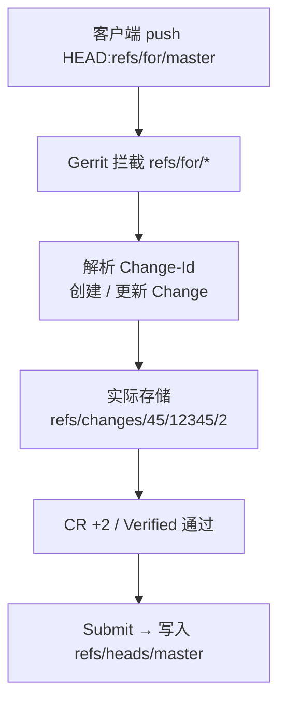
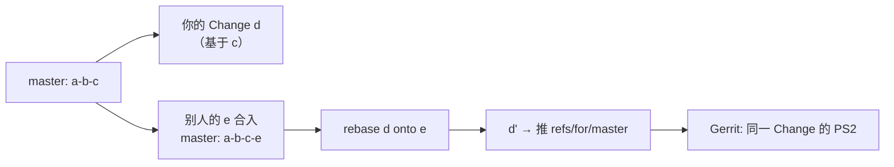

# 工程工具用法

> Git / Gerrit 日常提交、变基、冲突处理，以及 Bash 脚本语法笔记。持续补充。

## 目录

- [Git](#git)
  - [1. 一页速查卡](#1-一页速查卡)
  - [2. Gerrit 提交完整流程](#2-gerrit-提交完整流程)
  - [3. commit --amend 与 Change-Id](#3-commit---amend-与-change-id)
  - [4. git push 与 refs/for](#4-git-push-与-refsfor)
  - [5. 分支操作](#5-分支操作)
  - [6. git fetch 与 git pull](#6-git-fetch-与-git-pull)
  - [7. git rebase 与冲突处理](#7-git-rebase-与冲突处理)
  - [8. 查看与排查](#8-查看与排查)
- [Bash](#bash)
  - [1. 脚本头与变量](#1-脚本头与变量)
  - [2. 函数与参数](#2-函数与参数)
  - [3. 条件判断](#3-条件判断)
  - [4. 循环](#4-循环)
  - [5. 逻辑运算与输出](#5-逻辑运算与输出)
  - [6. 命令替换与管道](#6-命令替换与管道)
  - [7. 文本处理：cut](#7-文本处理cut)
  - [8. 常用文件操作](#8-常用文件操作)

---

# Git

## 1. 一页速查卡

| 目的 | 命令 |
| --- | --- |
| 取远端最新（只看不动） | `git fetch origin` |
| 基于最新远端开分支 | `git switch -c <分支> origin/master` |
| 把修改并进上一条提交 | `git add <文件> && git commit --amend --no-edit` |
| 变基到最新 master | `git rebase origin/master` |
| 冲突解决后继续 | `git add <文件> && git rebase --continue` |
| 放弃 rebase（无损） | `git rebase --abort` |
| 修正上一条提交信息 | `git commit --amend -m "..."` |
| 推到 Gerrit 评审 | `git push origin HEAD:refs/for/master` |
| 丢弃某文件的工作区改动 | `git restore <文件>` |
| 取消暂存 | `git restore --staged <文件>` |
| 切分支 | `git switch <分支>` |
| 查看当前分支 | `git branch --show-current` |
| 看远端比本机多什么 | `git log --oneline HEAD..origin/master` |
| 分叉点（基座）在哪 | `git merge-base HEAD origin/master` |

**三条铁律**

1. Gerrit 的 Change 必须是单父提交 —— **用 rebase，不用 merge**。
2. 已推给别人的提交不做 rebase（SHA 会变，别人历史对不上）。
3. 推 `refs/for/*` **永远不加 `--force`**。

---

## 2. Gerrit 提交完整流程

### 2.1 一套典型命令

```bash
cd ~/code/my-project
git checkout feature/my-fix
git commit --amend -m "PROJ-12345 【Prod】small-activate fix" \
                   -m "Change-Id: I35302ee2a70d9808a7ea3b7d8f2e67c14825c7f8"
git log -1
git push origin HEAD:refs/for/master
```

### 2.2 逐条含义

| 命令 | 作用 | 备注 |
| --- | --- | --- |
| `cd ~/code/my-project` | 进入仓库 | 构建机路径 |
| `git checkout feature/my-fix` | 切换分支 | 等价 `git switch feature/my-fix` |
| `git commit --amend -m ... -m ...` | 改写最后一条提交 | 两个 `-m` = 两个段落，中间自动空行 |
| `git log -1` | 本地确认 | 只验证本地，不代表 push 会成功 |
| `git push origin HEAD:refs/for/master` | 推到 Gerrit 评审队列 | 不会直接进 master |

### 2.3 生成的 message

```
PROJ-12345 【Prod】small-activate fix

Change-Id: I35302ee2a70d9808a7ea3b7d8f2e67c14825c7f8
```

---

## 3. commit --amend 与 Change-Id

### 3.1 本质：替换，不是修改

提交对象**不可变**。`--amend` 实际是"用新 message + 当前暂存区 + 原父提交，**新建**一个 commit，然后把分支指针移过去"。旧提交变成悬空对象，`git reflog` 可找回。

```
amend 前:  C1 ── C2 ── C3        ← HEAD
amend 后:  C1 ── C2 ── C3'       ← HEAD（C3 悬空）
```

**SHA 一定会变**（committer date 和 message 变了）。

### 3.2 哪些保留、哪些变

| 项目 | amend 后 |
| --- | --- |
| 父提交 | 不变 |
| 作者 / 作者时间 | 不变（除非 `--reset-author` / `--date`） |
| 提交者时间 | 刷新为当前时间 |
| 提交信息 | **被替换** |
| 文件内容 | **取自当前暂存区** |
| SHA | **必变** |
| 工作区未跟踪文件 | 不受影响 |

### 3.3 四种用法

```bash
# 1. 只改 message
git commit --amend -m "新的标题" -m "Change-Id: I..."

# 2. 改 message + 并入漏掉的文件
git add forgot.py
git commit --amend --no-edit          # 保证 Change-Id 不变

# 3. 只并入文件，不动 message
git add . && git commit --amend --no-edit

# 4. 改作者 / 时间
git commit --amend --reset-author
git commit --amend --no-edit --date="2026-11-07 10:00:00"
```

> ⚠️ `--amend -m "..."` 会**整条替换** message，`Change-Id` 一并丢失并被重新生成。
> 用 `-m` 时必须手动带上 `Change-Id`，且放在**最后一段**。

### 3.4 两个硬前提

1. **改动必须先 `git add`** —— amend 取的是**暂存区**，不是工作区。忘了 add 就是白改。
2. **只能改 HEAD** —— 更早的提交要用 `rebase -i` / `--fixup` / `reset --soft`。

### 3.5 Change-Id 是什么

- Gerrit 用它识别"**这是同一个 Change 的新版本**"。
- 改代码后 `amend` + 重推，`Change-Id` 不变 → Gerrit 记为 **Patch Set 2 / 3 …**，评审记录（评论、投票）全部保留。
- 漏了 `Change-Id` → 变成**新 Change**，原评审作废。
- 只认 **message 最后一段**里的 `Change-Id`，顺序不能颠倒。
- 格式：`I` + 40 位十六进制。

---

## 4. git push 与 refs/for

### 4.1 完整语法

```
git push  <远端名>  <本地引用>:<远端引用>
          origin    HEAD:refs/for/master
```

### 4.2 三个部分的含义

- `origin` → 推到**哪台服务器**。它是 `git clone` 给远端 URL 起的**默认昵称**。
- `HEAD` → 推**哪个提交**。`HEAD` = **当前分支的最新提交**。
- `refs/for/master` → 以什么形式推（Gerrit 评审队列）。

### 4.3 为什么是 refs/for/master

`refs/for/master` 是 Gerrit 的**虚拟引用命名空间**，用于 CR，服务端没有这个分支：



---

## 5. 分支操作

### 5.1 快速选择

| 需求 | 命令 |
| --- | --- |
| 只切换 | `git switch <分支名>` |
| 创建并切换（最常用） | `git checkout -b <分支名>` |
| 只创建不切换 | `git branch <分支名>` |
| 基于指定起点 | `git switch -c <分支名> <起点>` |
| 基于远端分支并追踪 | `git switch -c <分支名> --track origin/<分支>` |
| 查看当前分支 | `git branch --show-current` |

### 5.2 标准流程

```bash
git fetch origin                                   # 先同步
git switch -c fix_12345_small_activate origin/master     # 基于最新远端开分支
git status && git log --oneline -1                 # 确认
```

### 5.3 分支管理

| 操作 | 命令 |
| --- | --- |
| 查看本地分支 | `git branch` |
| 查看所有分支 | `git branch -a` |
| 查看追踪关系 | `git branch -vv` |
| 重命名 | `git branch -m <旧> <新>` |
| 删除已合并分支 | `git branch -d <分支>` |
| 强制删除 | `git branch -D <分支>` |
| 删除远端分支 | `git push origin --delete <分支>` |
| 切回上一个分支 | `git switch -` |

---

## 6. git fetch 与 git pull

### 6.1 区别

- `git fetch origin`：拉取**所有分支**的更新，只更新远程跟踪分支（`origin/*`），**不改本地分支、不动工作区**。
- `git pull origin <分支>`：`fetch` + 合并，把远端改动**自动并进当前分支**（可能产生 merge commit，也可能弹冲突）。

> Gerrit 场景下用 `fetch + rebase` 更可控；直接 `pull` 在本地有提交时会生成 merge commit，容易被 Gerrit 拒收。

### 6.2 常用参数

| 参数 | 作用 |
| --- | --- |
| `git fetch origin --prune` | 清理远端已删除的 `origin/xxx` |
| `git fetch --all` | 取所有远端 |
| `git fetch origin master` | 只取 master（主要写 FETCH_HEAD） |
| `git fetch origin refs/changes/45/12345/2` | 取 Gerrit 某个 PS |
| `git fetch --tags` | 同时取 tag |
| `git fetch --dry-run` | 只看会取什么 |
| `git fetch --depth=1` | 浅取，CI 常用 |

---

## 7. git rebase 与冲突处理

### 7.1 什么是换基座

当你的 Change 还没合入、而 master 已经前进了，就需要把自己的提交"搬"到最新代码之上 —— 这就是换基座。



### 7.2 基本命令

```bash
git rebase origin/master     # 在当前分支上换基座
git rebase --continue        # 冲突解决后继续
git rebase --abort           # 放弃，无损回到 rebase 之前
```

### 7.3 冲突处理

```bash
git status                   # 看 Unmerged paths
# 编辑文件，删掉 <<<<<<< ======= >>>>>>>
git add <冲突文件>
git rebase --continue        # 循环，直到 Successfully rebased
```

> ⚠️ rebase 冲突时 `ours` / `theirs` 是**反的**：
> `--ours` 取远端（origin/master）的版本，`--theirs` 取你这条提交的版本。

---

## 8. 查看与排查

- `git log --oneline --decorate`：看当前分支的提交历史。
- `git reflog show <分支名>`：看该分支指针的移动记录，包含 amend / reset / rebase 之前的旧提交，是找回顾失内容的入口。
- `git status`：看工作区状态，列出所有冲突文件。
- `git status -sb`：看当前分支与远端的领先 / 落后情况。
- `git branch --show-current`：看当前分支名。

---

# Bash

## 1. 脚本头与变量

*#!/bin/bash* 写在开头，告诉系统可以用 `/bin/bash` 来跑这个文件。

**`local`** 声明局部变量，引用变量时要加上双引号。

```bash
# 格式字符串
src="${base}/${group}/stdout/app.log"
```

---

## 2. 函数与参数

**`$1` `$2`**：函数（或脚本）的第 1、第 2 个参数。`$0` 是脚本/函数名本身，`$@` 是全部参数。

**定义函数**：`fetch_app_log() {...}`；**传入所有参数**：`fetch_app_log "$@"`。

---

## 3. 条件判断

**`[[ ... ]]`** 条件判断，写法为 `if 条件; then ... fi`。

- `-z "$x"`：字符串是否为空（zero length）
- `-n "$x"`：字符串非空
- `-f "$x"`：这个路径是否是一个已存在的普通文件
- `-d "$x"`：目录是否存在

---

## 4. 循环

```bash
for g in "$@"; do                      # 遍历所有参数，每次 g 取一个
    fetch_app_log "$g" || fail=1 # 下载它；失败就把 fail 标记为 1
done
```

**`seq -w 1 14`**：生成 1-14 的序列，`-w` 表示等宽补零 → `"01 02 ... 09 10 ... 14"`。

---

## 5. 逻辑运算与输出

- `A && B`：A 成功了才执行 B（逻辑与，短路）
- `A || B`：A 失败了才执行 B
- `echo ... >&2`：打印到标准错误

---

## 6. 命令替换与管道

- `$( ... )`：把括号中的命令输出作为字符串
- `|`：把左侧的输出作为右侧的输入

---

## 7. 文本处理：cut

`cut` 是按列裁剪文本的小工具，两个常用选项：

- `-f`：取第几个字段（field，即第几列），`-f1` 就是第 1 列
- `-d`：指定列的分隔符（delimiter），**默认是制表符 Tab**

```bash
echo "a,b,c" | cut -d',' -f1       # 输出 a    （用逗号分隔，取第 1 列）
echo "a,b,c" | cut -d',' -f2       # 输出 b
echo "a,b,c" | cut -d',' -f1,3     # 输出 a,c  （取第 1 和第 3 列）
echo -e "x\ty" | cut -f2           # 输出 y
```

---

## 8. 常用文件操作

- `du -h "$out"`：查看占用磁盘大小。
- `mkdir -p "$dst"`：建目录，`-p` 表示父目录不存在则创建。
- `${dst%/}`：路径结尾有 `/` 则删除。

```bash
dst="~/data/"
echo "${dst%/}"
```
